# Lab 08 – Securing a Non-Human Identity (and an AI Agent)

<!--
CLIENT CONFIRMATION NEEDED BEFORE PUBLISHING:
- Confirm repository name/visibility and the final lab number used in the portfolio.
- Screenshots are taken from the supplied lab guide (All Things Identity, Lab 8, Authentik 2026.8.5).
  Replace with your own captures if you have them.
- Confirm which two "forbidden" API calls you tested in Step 4 (the guide's examples are shown here).
- Confirm the owner name you recorded (screenshots show the placeholder "Your Name").
- The screenshot that displays the actual token key (guide Figure 8.36) is intentionally NOT included.
-->

<p align="center">
  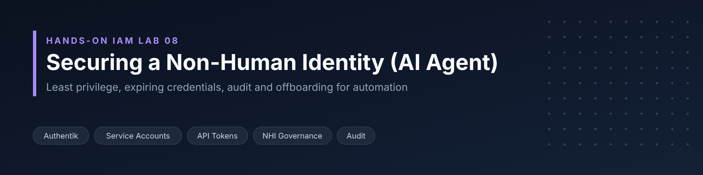
</p>

<p align="center">
  <strong>Professional Lab Documentation | Identity & Access Management / Cybersecurity</strong>
</p>

<p align="center">
  
  
  
  
</p>

---

## 📌 Project Overview

This lab takes a piece of automation — a **reporting agent** that could be an AI assistant — through the same identity lifecycle a person gets: its own identity, a named human owner, least-privilege access, a credential that expires by policy, an audit trail, and a clean, verified offboarding.

**The problem:** organizations run large numbers of non-human identities (scripts, integrations, service accounts and, increasingly, AI agents). They rarely get the attention people do: their tokens are created once, given too much access "to make it work", and left running for years. When one leaks, the attacker inherits all of it.

**Why it matters:** an AI agent that reads a directory needs exactly the same controls as any other automation. The terminology is new; the controls are not.

**Main objective:** scope, govern and retire a non-human identity in Authentik — and prove each control works, including the deny case.

## 🎯 Objectives

- Create a dedicated service account for the automation instead of sharing an admin login
- Record an accountable human owner and purpose for the identity
- Grant a single, least-privilege permission through a custom role
- Remove an unnecessary long-lived credential and enforce token lifetime through company policy
- Prove the token can perform its job **and** is refused for everything else
- Use the event log to establish accountability, and identify what the log does **not** capture
- Offboard the identity and prove its old credential no longer works

## 🏢 Scenario / Business Context

**Hero Co.** is rolling out a reporting agent that reads the employee directory to build headcount reports. Nobody logs in as it; it calls the identity system's API with a token instead of a password.

The organization needed to ensure the agent:

- Has its own identity, so its actions are not attributed to an administrator
- Has someone accountable for it
- Can read users — and nothing else
- Uses a credential whose lifetime is set by company policy, not by whoever creates it
- Can be fully switched off when the agent is retired, leaving no orphaned credential behind

## 🛠️ Technologies & Tools

| Technology / Tool | Purpose |
|---|---|
| **Authentik** (2026.8.x) | Identity provider: service accounts, roles/permissions (RBAC), tokens, system settings, event log |
| **Authentik REST API (`/api/v3/`)** | Built-in API browser used to retrieve the token key and test allowed/denied calls as the agent |
| **HTTP Bearer authentication** | How the agent's API token is presented to Authentik |
| **Authentik Events > Logs** | Audit trail for creation, deletion and secret-viewing events |
| **YAML user attributes** | Recording `owner` and `purpose` metadata on the service account |

## 🏗️ Architecture / Workflow

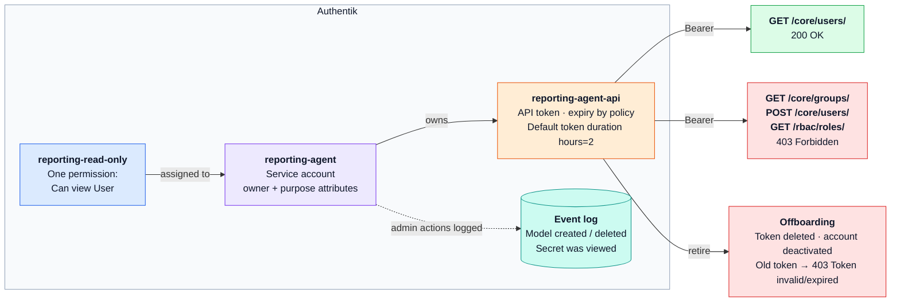

<sub>Static image version: <a href="assets/architecture.png">assets/architecture.png</a></sub>

`reporting-agent` is a service account with `owner` and `purpose` attributes. It holds one role, `reporting-read-only`, containing a single permission (**Can view User**). Its only credential is the API token `reporting-agent-api`, whose expiry is set by the system-wide **Default token duration**. Presented as a Bearer token, it succeeds on `GET /core/users/` and receives **403 Forbidden** elsewhere. The event log records administrative actions; offboarding deletes the token and deactivates the account.

**Lab workflow:**

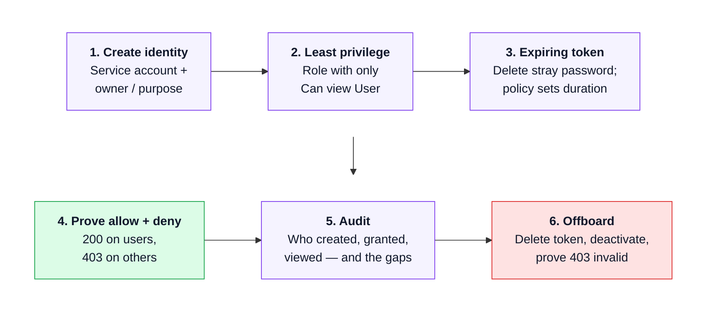

## ⚙️ Implementation / Steps Performed

### Step 1: Create the Non-Human Identity and Assign an Owner

In **Directory > Users > New User**, a **Service Account** named `reporting-agent` was created. Because Authentik has no built-in owner field in this edition, accountability was recorded as YAML attributes under **Edit User > Advanced settings > Attributes**:

```yaml
owner: <Owner Name>
purpose: Reads the user directory for headcount reports
```

<p align="center">
  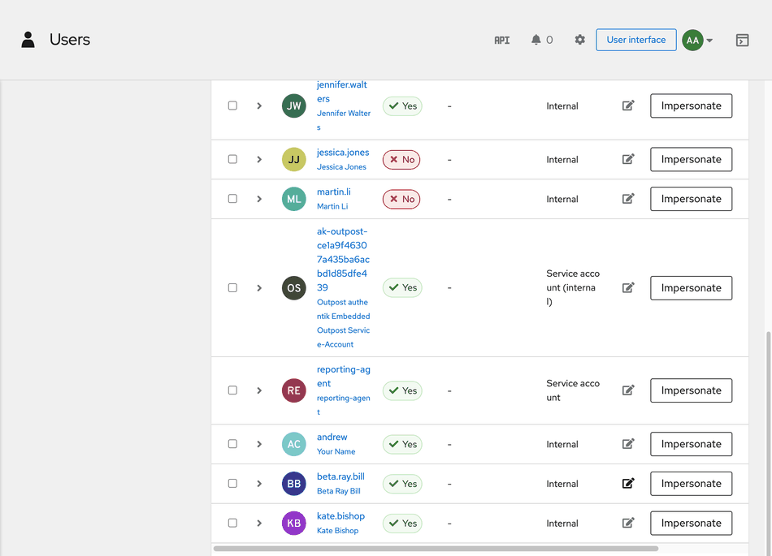
  <br><em>reporting-agent listed with type Service account.</em>
</p>

<p align="center">
  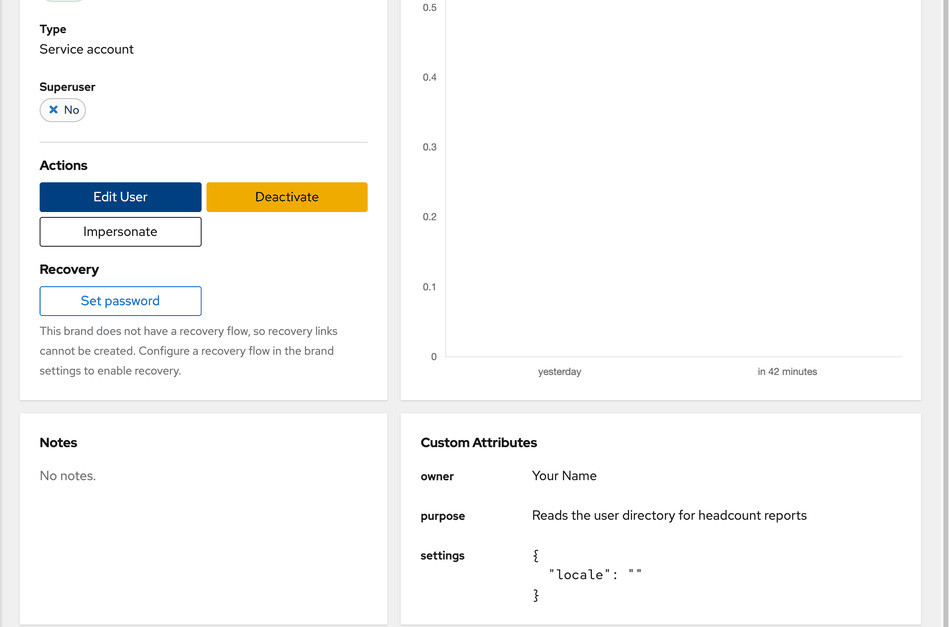
  <br><em>Owner and purpose recorded as custom attributes.</em>
</p>

### Step 2: Grant Least Privilege

A custom role, `reporting-read-only`, was created in **Directory > Roles** with exactly one permission: **authentik Core – Can view User**. Look-alike permissions (e.g. *Can view User Group*, *Can view User Role*) were deliberately avoided. The built-in *authentik Read-only* role was not used because it holds over a hundred view permissions — **read-only is not the same as least privilege**. The role was assigned to `reporting-agent` and verified from the agent's **Roles** tab.

<p align="center">
  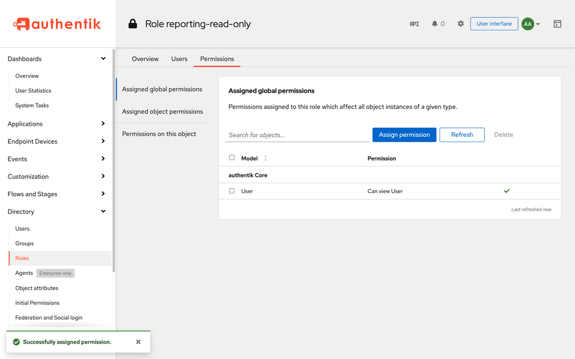
  <br><em>The role holds exactly one permission: Can view User.</em>
</p>

<p align="center">
  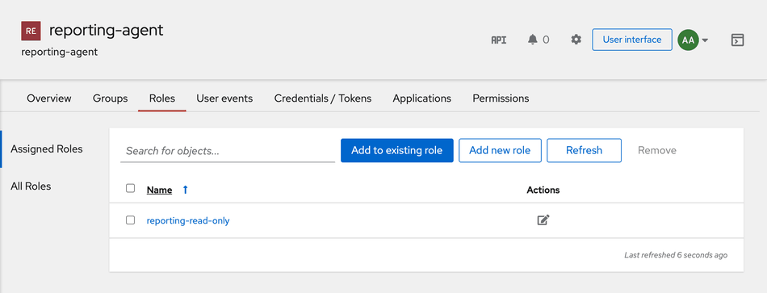
  <br><em>reporting-agent holds reporting-read-only.</em>
</p>

### Step 3: Issue a Token That Expires by Policy

Creating the service account had silently generated an **app password valid for ~12 months** that nothing used. That unused, long-lived secret was deleted. In **System > Settings**, **Default token duration** was tightened from `days=1` to `hours=2`. A new API token, `reporting-agent-api`, was then issued **owned by `reporting-agent`** (not the admin), and its expiry showed *"in 2 hours"* — set by policy, not by the form.

<p align="center">
  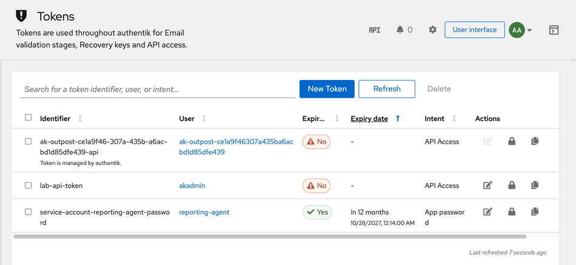
  <br><em>Finding: an auto-created, year-long app password nobody requested.</em>
</p>

<p align="center">
  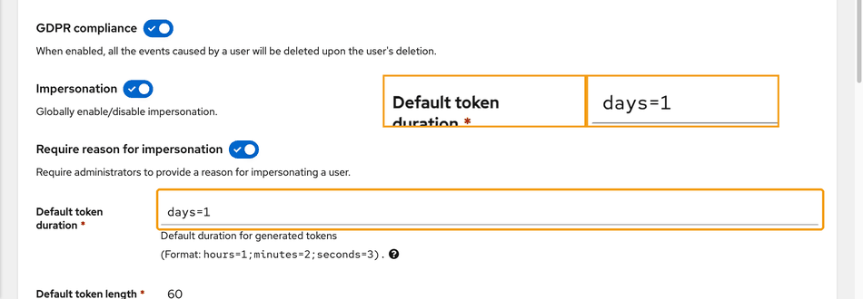
  <br><em>Company-wide Default token duration (changed from days=1 to hours=2).</em>
</p>

<p align="center">
  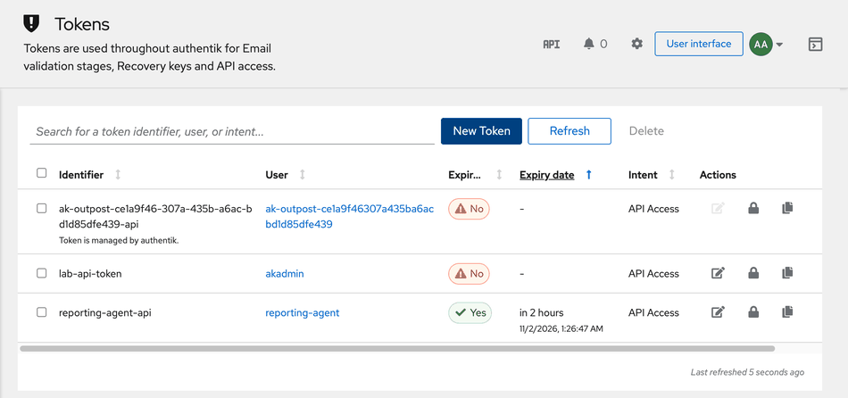
  <br><em>reporting-agent-api, owned by reporting-agent, expiring in 2 hours.</em>
</p>

### Step 4: Prove It Works — and Prove It Is Blocked

In Authentik's API browser (`/api/v3/`), the token key was retrieved via `GET /core/tokens/{identifier}/view_key/` (the clipboard is unavailable over HTTP) and set as the **HTTP Bearer** credential. Identity was confirmed first, so no test accidentally ran as the admin.

| Call | Purpose | Result |
|---|---|---|
| `GET /core/users/me/` | Confirm the caller's identity | `reporting-agent`, `is_superuser: false` |
| `GET /core/users/` | The agent's actual job | **200 OK** |
| `POST /core/users/` | Create a user | **403 Forbidden** |
| `GET /rbac/roles/` | Read roles | **403 Forbidden** |
| `GET /core/groups/` | Read groups (alternative test) | **403 Forbidden** |

A 403 is a pass: the token is valid, Authentik knows who is calling, and it refuses the action.

<p align="center">
  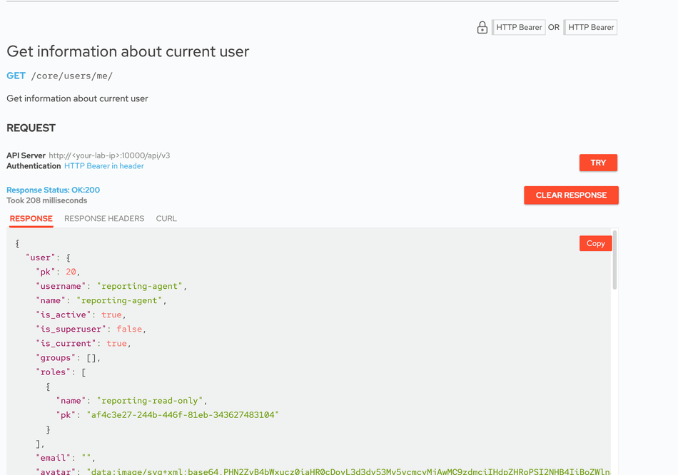
  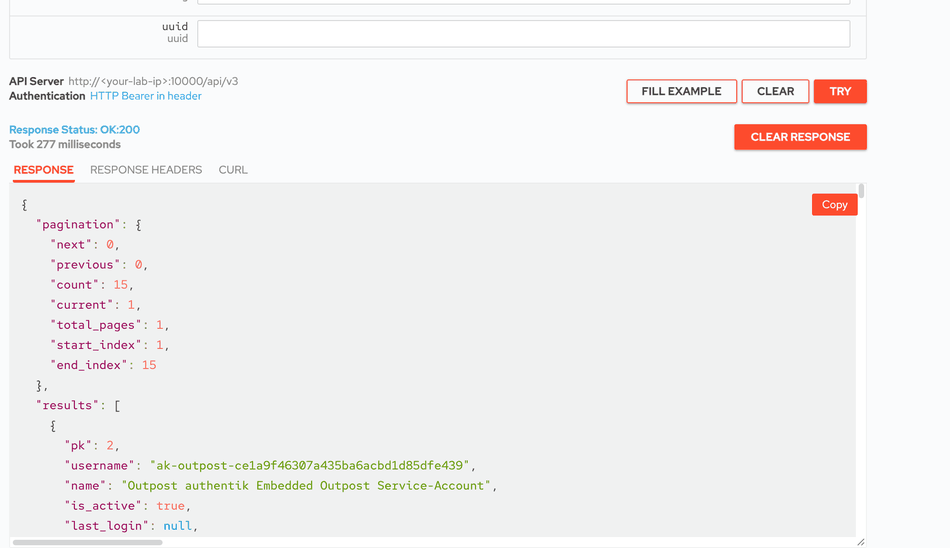
  <br><em>Caller confirmed as reporting-agent; reading users returns 200 OK.</em>
</p>

<p align="center">
  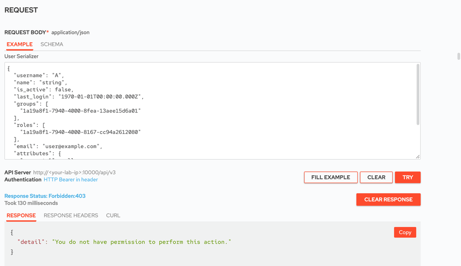
  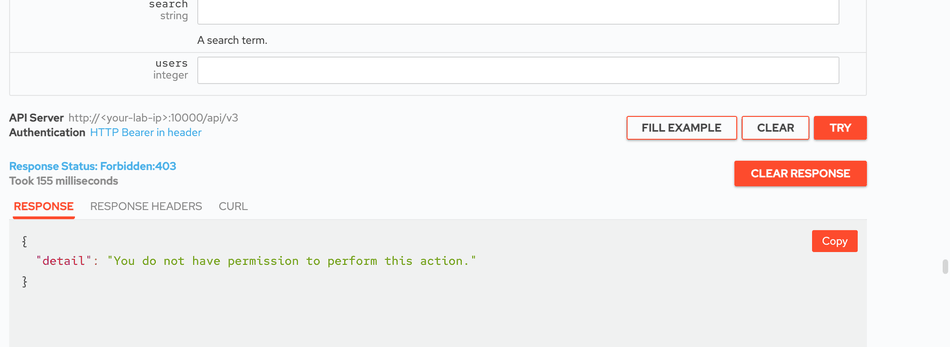
  <br><em>Creating a user and reading roles are both refused with 403.</em>
</p>

### Step 5: Establish Accountability from the Audit Trail

**Events > Logs** was used to answer who created the identity, who built its role, who issued its token, who viewed the token (*Secret was viewed*) and who deleted the year-long password. Two gaps were identified:

1. **The role assignment** to `reporting-agent` is not recorded as an event.
2. **The agent's own API calls** — allowed or refused — do not appear in the identity system's event log.

All administrative events were attributed to the shared `akadmin` account — itself a finding: in a real organization, these actions should name individual administrators.

<p align="center">
  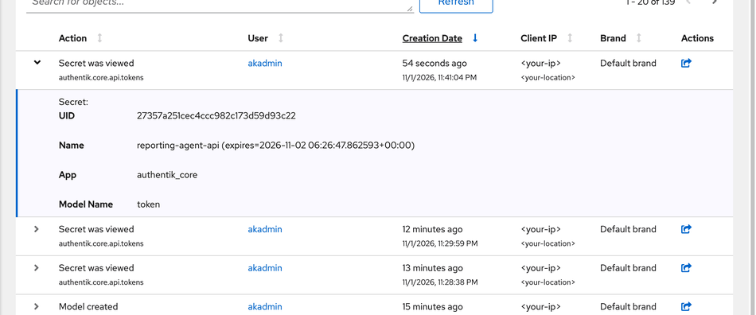
  <br><em>Authentik records that the token's key was viewed – naming the token, not the key.</em>
</p>

<p align="center">
  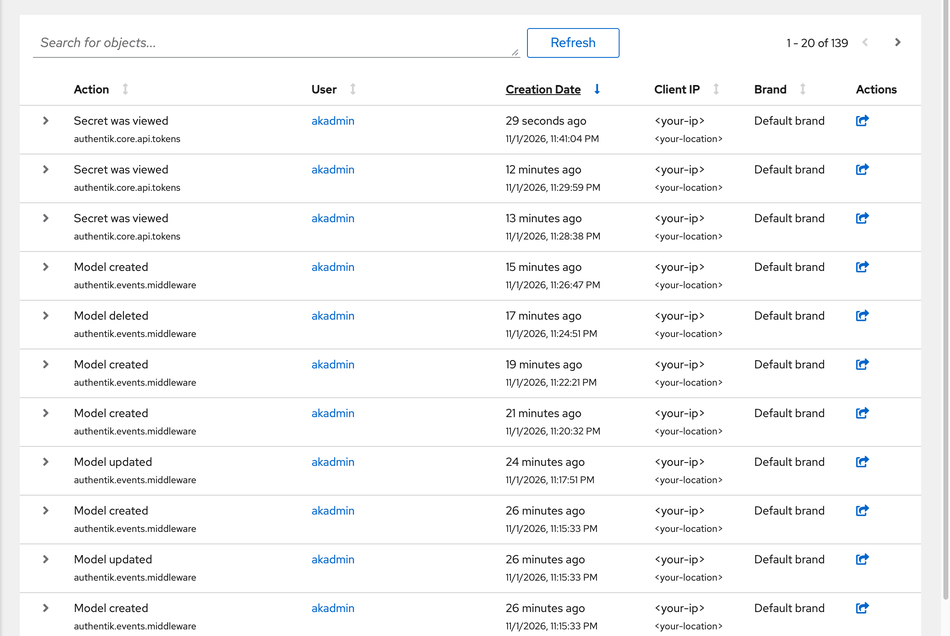
  <br><em>Every row is an administrative action; nothing comes from the agent itself.</em>
</p>

### Step 6: Offboard the Agent

With the old token still set in the API browser, the agent was retired: the `reporting-agent-api` token was deleted, the token list was checked for any remaining credential, and the account was **deactivated** (so a token issued by mistake would not work either). Re-running `GET /core/users/me/` with the old token returned **403 – "Token invalid/expired"**.

<p align="center">
  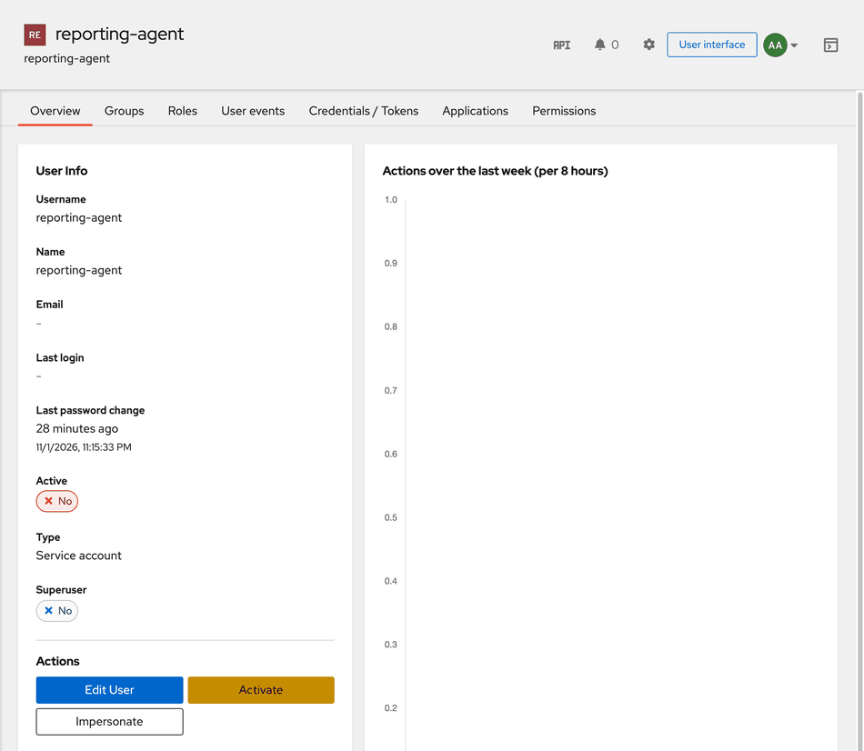
  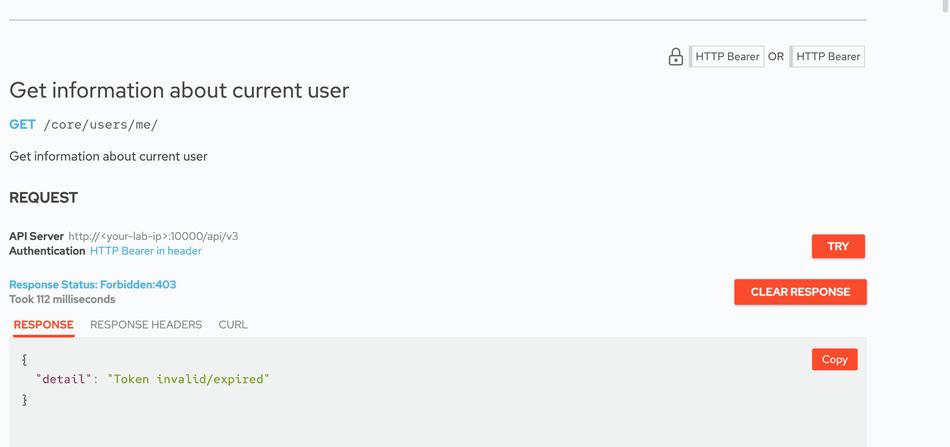
  <br><em>Account shows Active: No, and the old token is rejected.</em>
</p>

## 🔍 Key Findings / Results

- **Dedicated identity with accountability:** the agent runs as its own service account with a recorded owner and purpose.
- **Least privilege proven, not assumed:** one permission (`Can view User`); reading users returned 200 while out-of-scope calls returned 403.
- **Hidden long-lived secret removed:** creating a service account auto-generated a ~12-month app password that nobody used.
- **Credential lifetime set by policy:** token expiry followed *Default token duration* (2 hours) rather than the creator's choice.
- **Policy bypass identified:** turning off the *Expiring* switch creates a non-expiring token (e.g. the existing `lab-api-token`), so periodic review for non-expiring tokens is required.
- **Expiry ≠ retirement:** an expired API token is re-keyed, not removed; only deletion retires it.
- **Audit gaps documented:** role assignments and the agent's own API activity are not in the IdP event log; agent activity must be tracked in request/proxy logs or a monitoring tool, and grants need a ticket/approval record.
- **Shared admin attribution:** all admin actions appeared under `akadmin`.
- **Clean offboarding verified:** no credential remained, the account was inactive, and the old token returned 403 *Token invalid/expired*.

## 🧠 Skills Demonstrated

- Non-human identity (NHI) and AI agent governance
- Service account lifecycle management (create, scope, rotate/expire, offboard)
- Least-privilege RBAC design at the individual-permission level
- API token security and credential lifetime policy
- REST API testing with Bearer authentication, including negative (deny-case) testing
- Audit log analysis and identification of logging gaps
- Security findings and risk communication (orphaned/long-lived secrets, shared admin accounts)

## 📸 Screenshots & Evidence

| Evidence | What it shows |
|---|---|
| [Service account](assets/screenshots/step-01-service-account.png) | Dedicated non-human identity |
| [Single permission](assets/screenshots/step-02-single-permission.png) | Least-privilege role |
| [Year-long app password](assets/screenshots/step-03-year-long-app-password.png) | Unused long-lived secret (removed) |
| [Token expiring in 2 hours](assets/screenshots/step-03-token-two-hours.png) | Policy-driven expiry |
| [Create user 403](assets/screenshots/step-04-create-user-403.png) | Deny case proven |
| [Secret was viewed](assets/screenshots/step-05-secret-viewed-event.png) | Audit of secret access |
| [Token invalid 403](assets/screenshots/step-06-token-invalid-403.png) | Offboarding proven |

> The screenshot displaying the actual token key has been intentionally excluded from this repository.

## 💼 Real-World Relevance

- **Enterprise environments:** service accounts, integrations and AI agents frequently outnumber human users; each needs an owner, scoped access and an exit plan.
- **IT operations:** short, policy-driven credential lifetimes and documented ownership reduce the risk of forgotten automation breaking or leaking.
- **Identity and access management:** major identity providers offer their own mechanisms for linking agents and workload identities to accountable humans — the same principle recorded manually here.
- **Cybersecurity operations:** leaked or orphaned tokens are a common breach path; deny-case testing and alerting on *Secret was viewed* events strengthen detection.
- **Compliance and audit:** quarterly reviews of non-human identities, checks for non-expiring tokens and approval records for every grant close the gaps found in the event log.

## 📝 Summary

This lab governed a non-human identity — an automated reporting agent — through its full lifecycle in Authentik. The agent received its own service account, a named owner, a single read permission and a policy-controlled expiring token. Both the allowed and denied paths were proven through the API, the audit trail was used to establish accountability and expose its blind spots, and the agent was offboarded with proof that its old credential no longer works. The same controls apply directly to AI agents: for them, this is the floor, not the ceiling.

## ⚠️ Disclaimer

This project is documented for educational and portfolio purposes. It was performed in a personal lab environment, not in production. The lab ran over HTTP for simplicity; production systems must use HTTPS. Screenshots and scenario details are based on the supplied lab materials (*All Things Identity – Hands-On IAM Labs, Lab 8*). No passwords, tokens or keys are included.

---

<p align="center">
  <strong>Created as part of a professional cybersecurity and IAM portfolio.</strong>
</p>
